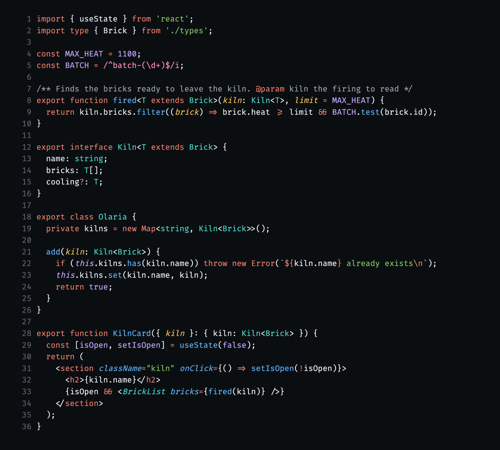
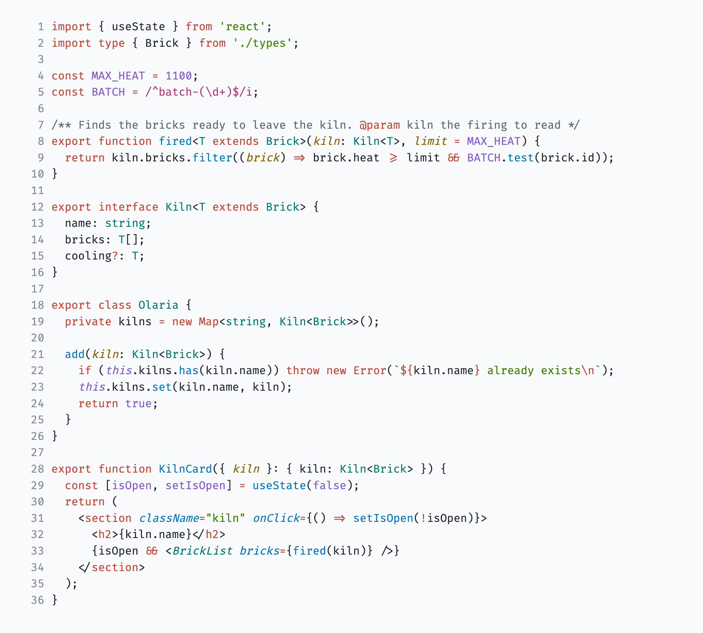

# Barro

Clay on slate, with the contrast to read code all day. **Barro Slate** for the dark and **Barro Kaolin** for the light.

Keywords carry the clay color, so a file has a shape before you read a word of it. Each color has one job: sky is what runs, teal is the shape of data, sage is text, lavender is a fixed value, straw is what was passed in, and rose is a pattern. Errors get their own red, so a problem never looks like a keyword.

Pick a Barro variant with `Preferences: Color Theme`. Language server highlighting and rainbow brackets work out of the box.

The full spec, and Barro for other apps, is at [github.com/irwinarruda/barro-theme](https://github.com/irwinarruda/barro-theme).
